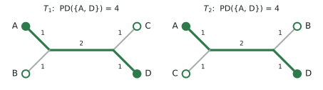

Background
==========

This page defines the problem ForestPD solves and outlines the algorithm. The manuscript (see the
citation on the :doc:`front page <index>`) has the definitions, proofs and experiments.

Phylogenetic diversity
----------------------

One tree
~~~~~~~~

Let :math:`X` be a finite set of taxa. A phylogenetic tree :math:`\mathcal{T} = (T, \omega)` on
:math:`X` consists of a tree :math:`T` whose leaves are labelled bijectively with the taxa in
:math:`X`, and an edge weight function :math:`\omega \colon E(T) \to \mathbb{Q}_{\geq 0}` (the
branch lengths). An internal vertex of degree larger than 3 is a polytomy, and a tree without
polytomies is binary. For a set :math:`A \subseteq X`, :math:`E_{\mathcal{T}}(A)` is the edge set
of the spanning tree of :math:`A`, the smallest subtree of :math:`\mathcal{T}` that contains the
leaves in :math:`A`. The **phylogenetic diversity** (PD) of :math:`A` is [Faith1992]_

.. math::

   \mathrm{PD}_{\mathcal{T}}(A) = \sum_{e \in E_{\mathcal{T}}(A)} \omega(e),

the total weight of the edges on paths between taxa in :math:`A`. Closely related taxa share most
of their branches, so protecting both adds little over protecting one. PD therefore favours sets
of complementary taxa, which is why conservation planning maximizes the PD of a set rather than
ranking taxa individually.

By default PD is **unrooted**, as defined above, so a single taxon has PD 0. With ``rooted=True``
it is **rooted** PD: the branches from the chosen taxa to the root, plus the root's own branch,
count (see :ref:`manual-rooted`).

On one tree, a set of :math:`m` taxa with the largest PD can be found greedily [Steel2005]_
[Pardi2005]_, and tools such as PDA solve this for large trees within seconds [Minh2006]_.

Many trees
~~~~~~~~~~

A phylogenetic analysis usually gives several trees: a Bayesian posterior sample, bootstrap
replicates, or gene trees that differ from each other and from the species tree, for example
through incomplete lineage sorting. ForestPD maximizes the **weighted sum of PD** over a collection
:math:`\mathcal{T} = \{\mathcal{T}_1, \dots, \mathcal{T}_t\}` of trees on :math:`X`, instead of the
PD on a single or summary tree:

.. math::

   \sum_{i=1}^{t} w(\mathcal{T}_i) \cdot \mathrm{PD}_{\mathcal{T}_i}(A).

The tree weights :math:`w(\mathcal{T}_i) > 0` can be posterior probabilities (the objective is
then the expected PD under phylogenetic uncertainty), :math:`1/t` (the average PD over the trees),
or any other weighting, such as alignment lengths for gene trees.

For example, the two trees below have the same four taxa but different topologies. On
:math:`\mathcal{T}_1` every pair across the middle edge, such as :math:`\{A, C\}`, has the largest
PD, 4. In :math:`\mathcal{T}_2` the taxa :math:`A` and :math:`C` are siblings, and the same pair
has PD 2. Only :math:`\{A, D\}` and :math:`\{B, C\}` have PD 4 in both trees, for a total of 8:

   Two trees on taxa A–D, with branch lengths. The highlighted edges connect :math:`A` and
   :math:`D`: PD 4 in each tree, 8 in total. :math:`\{A, C\}` has PD 4 in :math:`\mathcal{T}_1` but
   only 2 in :math:`\mathcal{T}_2`.

.. code-block:: python

   >>> import forestpd as fpd
   >>> trees = ["(A:1,B:1,(C:1,D:1):2);", "(A:1,C:1,(B:1,D:1):2);"]
   >>> instance = fpd.MaxMPDInstance(trees)
   >>> instance.evaluate_pd({"A", "C"}), instance.evaluate_pd({"A", "D"})
   (6.0, 8.0)
   >>> instance.optimize(budget=2).value
   8.0

Costs and a budget
~~~~~~~~~~~~~~~~~~

Each taxon :math:`x` has an integer cost :math:`c(x) \geq 1`, and the protected set :math:`S` must
fit a budget :math:`B`: :math:`c(S) \leq B`, where :math:`c(S) = \sum_{x \in S} c(x)`. With unit
costs (the default) the budget is the number of taxa.

Extinction risk
~~~~~~~~~~~~~~~

Each taxon :math:`x` has a survival probability :math:`a(x)`: the probability that it survives
without protection. For a protected set :math:`S`, let :math:`a_S(x) = 1` if :math:`x \in S` and
:math:`a_S(x) = a(x)` otherwise. Taxa survive independently, so the probability that exactly the
taxa in :math:`A` survive is

.. math::

   a_S(A) = \prod_{x \in A} a_S(x) \prod_{x \in X \setminus A} \big(1 - a_S(x)\big),

and the expected weighted PD of the survivors is [Weitzman1998]_

.. math::

   \sum_{A \subseteq X} a_S(A) \sum_{i=1}^{t} w(\mathcal{T}_i) \cdot \mathrm{PD}_{\mathcal{T}_i}(A).

An edge contributes if a taxon survives on each of its sides. ForestPD therefore computes the
expectation per edge: an edge :math:`e` that splits :math:`X` into :math:`X_e` and
:math:`\overline{X}_e` contributes :math:`\omega(e)` times
:math:`\big(1 - \prod_{x \in X_e} (1 - a_S(x))\big) \big(1 - \prod_{x \in \overline{X}_e}
(1 - a_S(x))\big)`. With every :math:`a(x) = 0` (the default), the objective is the weighted PD of
:math:`S`.

MaxMPD
------

.. admonition:: Maximize Multi-Tree Phylogenetic Diversity (MaxMPD)

   **Input:** a set of taxa :math:`X`; a collection
   :math:`\mathcal{T} = \{\mathcal{T}_1, \dots, \mathcal{T}_t\}` of phylogenetic trees on
   :math:`X`; tree weights :math:`w \colon \mathcal{T} \to \mathbb{Q}_{> 0}`; taxon costs
   :math:`c \colon X \to \mathbb{N}_{> 0}`; survival probabilities
   :math:`a \colon X \to [0, 1) \cap \mathbb{Q}`; and a budget :math:`B \in \mathbb{N}_{> 0}`.

   **Output:** a set :math:`S \subseteq X` with :math:`c(S) \leq B` that maximizes
   :math:`\sum_{A \subseteq X} a_S(A) \sum_{i=1}^{t} w(\mathcal{T}_i) \cdot
   \mathrm{PD}_{\mathcal{T}_i}(A)`.

We write :math:`n = |X|` for the number of taxa and :math:`t = |\mathcal{T}|` for the number of
trees. The trees may be rooted or unrooted (with ``rooted=True``) and binary or not, but every tree
must contain every taxon. MaxMPD is NP-hard already for three trees. ForestPD's algorithm is fast
when the trees differ only locally, as trees inferred from the same data typically do.

Algorithm
---------

ForestPD solves MaxMPD exactly, in three stages.

Cluster reduction
~~~~~~~~~~~~~~~~~

Wherever every tree has the same split of the taxa (an edge separating the same two groups), the
instance is cut at that split into smaller instances, one per *cluster*, with a placeholder leaf
for the rest of the trees. The clusters form a tree and are solved from the leaves up: each
cluster passes its optimal value per budget to its parent. Trees that share most of their
structure give many small clusters.

Agreement forests
~~~~~~~~~~~~~~~~~

Within a cluster, the trees still differ. An *agreement forest* partitions the cluster's leaves
into :math:`k` components such that every component has the same topology in every tree, and in
each tree the components occupy disjoint parts. Its size :math:`k` measures how much the trees
differ in that cluster: :math:`k = 1` means they agree completely. Finding a smallest agreement
forest is NP-hard, but every agreement forest gives the exact optimum; a smaller one makes the next
stage faster. ForestPD's default is a fast heuristic (:class:`~forestpd.maf.HeuristicMAF`); with
the optional `maffe <https://github.com/roehrt/maffe>`_ package it can use minimum agreement
forests (see :ref:`manual-maf`).

Dynamic programming over signatures
~~~~~~~~~~~~~~~~~~~~~~~~~~~~~~~~~~~

For each cluster and each *signature*, the subset of components that contain a protected taxon,
the objective splits into a constant plus independent contributions of the components. Each
component's contribution is computed for every budget by a dynamic program along its trees, and
the budgets are divided over the components by max-plus convolution.

Running time
~~~~~~~~~~~~

With :math:`2^k` signatures per cluster, the running time is

.. math::

   O\big(2^k \cdot n \cdot t \cdot \min(B, C - B)^2\big)

for budget :math:`B` and total cost :math:`C = c(X)`, where :math:`k` is the largest
agreement-forest size over the clusters. The :math:`\min(B, C - B)` comes from two kinds of
tables: ones indexed by the budget spent (up to :math:`B`), and complementary ones indexed
by the budget left unspent (up to :math:`C - B`). ForestPD computes whichever is smaller for the
requested budgets, or both. In practice:

* **Budget curves.** The tables cover every budget up to :math:`B`, so one run gives the optimum
  for every smaller budget as well (see :ref:`manual-curves`).
* **Hard instances** have a large :math:`k` in some cluster, which occurs where many taxa are
  placed differently by different trees, and, to a lesser extent, a large budget in cost units
  (fine-grained costs). The numbers of trees and taxa enter only linearly.
  :meth:`~forestpd.MaxMPDInstance.structure` reports :math:`k` before solving.

References
----------

.. [Faith1992] D. P. Faith. Conservation evaluation and phylogenetic diversity. *Biological
   Conservation* 61(1):1–10, 1992.
.. [Steel2005] M. Steel. Phylogenetic diversity and the greedy algorithm. *Systematic Biology*
   54(4):527–529, 2005.
.. [Pardi2005] F. Pardi and N. Goldman. Species choice for comparative genomics: being greedy
   works. *PLoS Genetics* 1(6):e71, 2005.
.. [Minh2006] B. Q. Minh, S. Klaere, and A. von Haeseler. Phylogenetic diversity within seconds.
   *Systematic Biology* 55(5):769–773, 2006.
.. [Weitzman1998] M. L. Weitzman. The Noah's Ark problem. *Econometrica* 66(6):1279–1298, 1998.
